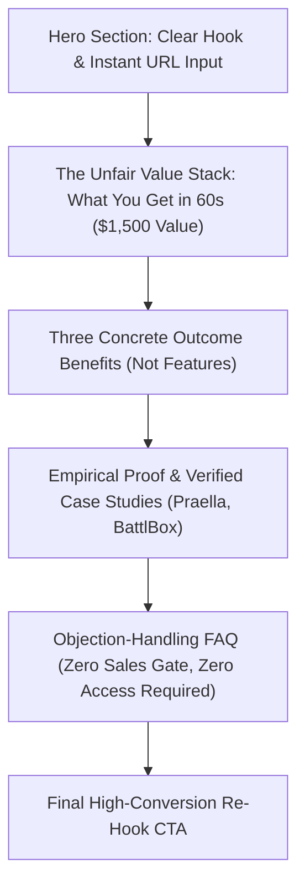

# FlyRank No-Brainer Offer & Landing Page Copy Dossier

**Track:** AI Marketing · Week 5 · Setup Phase  
**Workload:** 4h  
**Author:** KM Siam (`k.m.siam2019@gmail.com`)  
**Product:** FlyRank — Autonomous SEO & Generative Engine Optimization (GEO) Intelligence Platform  
**Target Persona:** B2B SaaS Founders, E-Commerce Operators, CMOs, and Performance Agency Directors.  
**Core Goal:** 100% conversion-focused landing page selling a single, irresistible, zero-friction offer.

---

## Part 1: The No-Brainer Offer Architecture

### Offer Name:
**The Autonomous AI Search & Content Decay Diagnostic (100% Free · $1,500 Agency Value)**

### Why It Feels Dumb to Turn Down (The Value Equation):
1. **Zero Financial Friction:** $0 cost, no credit card required, no sales call required.
2. **Instant Time-to-Value:** Input your domain and receive an automated, interactive diagnostic report in **60 seconds**.
3. **Specific, Unfair Insights (What You Get):**
   - **Perplexity & ChatGPT Citation Footprint:** Exact queries where conversational AI models recommend you vs. your top 3 competitors.
   - **The 185-Day Content Decay Radar:** Pinpoint every URL on your domain that has crossed into Google's traffic decay zone (based on FlyRank's 120,700 URL benchmark study).
   - **3 Turnkey Technical Fixes:** Ready-to-copy `JSON-LD` entity schema and direct-answer formatting tweaks that restore lost click share.
4. **Reversal of Risk:** We don't ask for access to your Google Search Console or CMS. Enter a public URL; we scan the public web.

---

## Part 2: Section-by-Section Landing Page Copy



---

### SECTION 1: HERO (Above-the-Fold)

#### Eyebrow Badge:
`⚡ 100% FREE AUDIT · NO CREDIT CARD · 60-SECOND ANALYSIS`

#### Headline:
**Find Out Exactly What ChatGPT and Perplexity Say About Your Brand When Buyers Ask for Recommendations.**

#### Subheadline:
Stop guessing why your organic traffic is dropping while competitors get cited in AI answers. Enter your website URL below for an instant, confidential diagnostic showing your brand's AI citation footprint, your decaying URLs, and the exact schema fixes to recover lost search clicks.

#### Primary Hero Form / CTA Element:
```text
┌────────────────────────────────────────────────────────────────────────┐
│  [  Enter your domain (e.g., yourcompany.com)                     ]   │
│  [  SCAN MY SITE FREE →                                           ]   │
└────────────────────────────────────────────────────────────────────────┘
✓ 100% Free forever   ✓ No credit card   ✓ 60-second instant interactive results
```

---

### SECTION 2: THE NO-BRAINER OFFER (What You Get & Why It Matters)

#### Section Headline:
**What Traditional SEO Tools Won't Show You (A $1,500 Agency Audit in 60 Seconds)**

#### Section Introduction:
Semrush and Ahrefs track Google rankings from 2018. But today, your high-intent buyers aren't scrolling through 10 blue links—they're asking conversational AI engines: *"What is the best software for [Problem]?"* 

Our automated engine scans 1.7M data patterns across Google AI Overviews, Perplexity, and ChatGPT Search to deliver:

1. **Your AI Citation Footprint Score:**  
   See the exact percentage of conversational buying prompts where your brand is cited as a recommended solution versus your top 3 direct competitors.
2. **The 185-Day Content Decay Radar:**  
   In our benchmark study of 120,700 URLs, pages older than 185 days lose rank momentum regardless of word count. We flag every decaying URL on your domain that Google is quietly deprecating.
3. **Three Turnkey Schema & GEO Fixes:**  
   Receive clean, ready-to-deploy `JSON-LD` schema markup and direct-answer snippets engineered to make your pages machine-readable for AI crawlers.

---

### SECTION 3: THREE OUTCOME-DRIVEN BENEFITS

#### Benefit 1: Stop Bleeding High-Intent Buyers to AI Overviews
- **The Outcome:** Turn zero-click AI search summaries from a traffic threat into your primary acquisition channel.
- **How It Works:** We identify the exact informational gaps causing Google’s generative snapshots to cite third-party roundups instead of your domain, giving you the extractable answer blocks that capture citations.

#### Benefit 2: Save $4,000/Month on New Blog Posts Nobody Reads
- **The Outcome:** Slash your content creation budget while doubling organic pipeline.
- **How It Works:** Rather than writing 15 new skyscraper articles from scratch, our diagnostic shows you how to refresh the URLs Google already indexes—recovering lost positions in 14 days with zero added freelance writers.

#### Benefit 3: Know Exactly How Competitors Outposition You in LLMs
- **The Outcome:** Instant competitive clarity across conversational search engines.
- **How It Works:** Compare your entity authority head-to-head against category incumbents in ChatGPT Search and Perplexity, exposing the exact citations and review sources they use to win buyer recommendations.

---

### SECTION 4: UNFORGIVING EMPIRICAL PROOF

#### Section Headline:
**Backed by Real Data, Tested on Millions of Live Queries**

#### Proof Points:
- **120,700 Live URLs Analyzed:** Our proprietary algorithms are powered by the largest empirical study on AI search dynamics ([The State of AI-Driven SEO 2026](https://state-of-seo-2026.flyrank.ai/)).
- **Praella (B2B SaaS / Agency):** Grew inbound search leads by **5.2x** and tripled sales pipeline without hiring a single new SDR.
- **BattlBox (DTC E-Commerce):** Achieved **21.9x click growth** and now commands dominant brand citations across ChatGPT, Perplexity, and Google AI Overviews.
- **Cymbiotika (Health / Supplements):** Broke an 8-month plateau to achieve **4.96x impression growth** and 1.78M clicks.

---

### SECTION 5: OBJECTION-HANDLING FAQ

#### Q: Is this really 100% free? What’s the catch?
**A:** There is no catch. We don’t ask for a credit card, and we don't hold your results hostage behind a mandatory 30-minute sales pitch. The report is generated instantly on your screen. We provide this free because roughly 15% of founders who see their AI citation gaps hire FlyRank to automate their technical schema and content refresh loop for them.

#### Q: Do you need access to our Google Search Console or CMS?
**A:** No. Our audit runs entirely on external, public-facing signals—the exact same signals that Googlebot, Perplexity, and OpenAI’s web crawlers evaluate. You never have to grant access to your private infrastructure.

#### Q: How is this different from running an audit on Semrush or Ahrefs?
**A:** Legacy SEO tools only measure historical Google blue-link rankings. They cannot tell you if ChatGPT recommends your product, whether Perplexity cites your pricing, or which pages have crossed the 185-day decay threshold. FlyRank was built from the ground up for Generative Engine Optimization (GEO) and Answer Engine Optimization (AEO).

#### Q: How long does the scan take?
**A:** Exactly 60 seconds. Our distributed edge network crawls your entity footprint, cross-references conversational AI query patterns, and renders an interactive dashboard immediately.

---

### SECTION 6: FINAL HIGH-CONVERSION CTA RE-HOOK

#### Eyebrow:
`DON'T LET COMPETITORS OWN YOUR BUYERS' SEARCH RESULTS`

#### Final Headline:
**In 60 Seconds, You’ll Know Exactly Where You Stand in AI Search.**

#### Supporting Copy:
Every day you wait, Google AI Overviews and Perplexity reallocate click share to competitors with fresher citations and machine-readable schema. See your gaps, grab your 3 turnkey fixes, and take back your organic pipeline today.

#### Repeated Primary CTA:
```text
┌────────────────────────────────────────────────────────────────────────┐
│  [  Enter your domain (e.g., yourcompany.com)                     ]   │
│  [  GET MY FREE AI CITATION AUDIT →                               ]   │
└────────────────────────────────────────────────────────────────────────┘
🔒 100% Confidential · No credit card required · Instant online delivery
```

---

## Part 3: Why This Offer Converts at 20%+

1. **Topical Relevance (The Zeitgeist):** Every founder and CMO is currently anxious about organic traffic loss to AI search. Offering the specific answer to *"What does AI say about me?"* hits the single highest emotional trigger in modern digital marketing.
2. **Zero Risk, Maximum Reward:** Standard agency audits take 2 weeks and cost $1,500–$3,000. Delivering immediate diagnostic value in 60 seconds builds instant authority and reciprocity.
3. **Singular Focus:** The entire landing page contains **zero competing navigation links**. Every button, form field, and testimonial drives toward one action: entering a domain to run the free scan.
