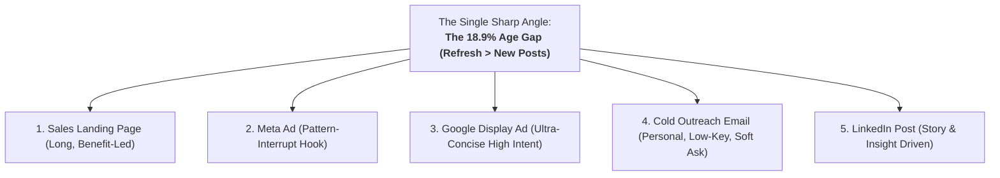

# One Angle, Five Channels: Strategic Multi-Channel Copywriting Blueprint

**Track:** AI Marketing · Week 4 · Setup Phase  
**Workload:** 3h  
**Author:** KM Siam (`k.m.siam2019@gmail.com`)  
**Product:** FlyRank — Autonomous SEO & Generative Engine Optimization Platform  
**Target Audience:** B2B SaaS Founders, Growth Marketers, and SEO Agency Directors.

---

## 1. Original Source Copy & Context

### Source
FlyRank Primary Website / Data Report Platform ([`https://state-of-seo-2026.flyrank.ai/`](https://state-of-seo-2026.flyrank.ai/))  
*Core Claim from Finding 1 & The Executive Overview:*
> *"Word count is almost the same in both groups (1.5K vs 1.5K). Age is the real gap. Growing pages are 18.9% younger (185 vs 228 days). Declining pages aren't necessarily bad — many still get traffic. They're just older and losing momentum. Stop publishing more content. Fix the pages Google already sees."*

---

## 2. The Chosen Angle

### The Angle: **"The 18.9% Age Gap (Stop Publishing New Posts; Refresh What Google Already Sees)"**
- **The Core Problem:** Marketing teams are stuck on an expensive content treadmill—spending $5,000 to $20,000/month producing 15 to 30 net-new blog posts while their existing, high-ranking pages silently lose traffic after day ~185.
- **The Counter-Intuitive Truth:** Growing pages and dying pages have the exact same length (~1,480 words). Word count has near-zero impact on ranking recovery. Content decay is caused by **age and stale entity citations**.
- **The Strategic Shift:** Reallocate 50% of content budget to an automated refresh engine that injects fresh schema, answers, and data into URLs Google already indexes.

---

## 3. The Five Channel Rewrites



---

### Channel 1: Sales Landing Page (Above-the-Fold + Benefit Section)
*Long, benefit-led, builds methodical proof to an ungated CTA.*

#### Headline & Subhead
```text
[EYEBROW BADGE]: THE 2026 CONTENT DECAY ENGINE
Headline: Your Top 10 Blog Posts Are Losing Traffic. Writing More Content Won't Save Them.
Subhead: FlyRank analyzed 120,700 URLs and found that growing pages and declining pages have the exact same word count (1,480 words). The real killer? Age. Growing pages are 18.9% younger. FlyRank autonomously diagnoses and refreshes the URLs Google already indexes—recovering lost clicks in 14 days without hiring more writers.
```

#### Body Copy (Problem & Solution Framing)
```text
You're stuck on the content treadmill.

Every month, your content team or agency writes 20 new articles. Every month, you watch your organic traffic graph tick down by 3%.

Why? Because your 2024 winners have entered the Decay Zone.

After approximately 185 days without an entity refresh, search algorithms begin testing newer competitors. Your pages don't lose rank because they're poorly written—they lose rank because they've lost informational momentum.

FlyRank flips the equation:
• Instant Entity Diagnostic: Point FlyRank at your sitemap to pinpoint every URL crossing the 185-day decay cliff.
• Autonomous Schema & Data Injection: Automatically embed JSON-LD microdata, updated 2026 statistics, and conversational answer snippets that AI crawlers prioritize.
• 14-Day Rank Velocity Recovery: Keep the traffic you already earned instead of paying $400 for another 2,500-word post nobody reads.
```

#### Primary Call-to-Action (CTA)
```text
[BUTTON]: Run a Free 60-Second Content Decay Audit →
(No credit card required · Instant 3-point technical diagnosis)
```

---

### Channel 2: Meta Ad (Facebook & Instagram Feed)
*Casual, pattern-interrupt hook that stops thumbs mid-scroll.*

#### Primary Text
```text
Before you pay an agency another $3,000 for "10x skyscraper blog posts," look at this number:

1,487 vs. 1,481.

We just audited 120,700 live URLs. That’s the average word count of pages gaining Google traffic versus pages actively dying.

A 6-word difference. Word count is completely irrelevant.

The actual metric deciding whether you rank or tank?

Age.

Growing pages are 18.9% younger (185 days vs. 228 days). 

After ~200 days, Google starts pulling impressions away from old guides to test fresher sources. Your content isn’t bad—it just expired.

Stop writing new posts from scratch. Run your domain through our free scanner to see which of your old URLs are in the decay zone and how to recover them in 48 hours 👇
```

#### Creative Spec & Headline
- **Visual:** Split bar chart graphic on dark navy canvas showing `Growing Pages: 1,487 words` vs `Dying Pages: 1,481 words` with a giant green `18.9% YOUNGER` badge.
- **Headline:** Stop writing new blogs. Fix the old ones.
- **Link Description:** Free Content Decay Scanner for Founders & Marketers
- **CTA Button:** Learn More

---

### Channel 3: Google Display Ad (Responsive Display / Banner Ad)
*Ultra-compact, every word counts, laser-focused on bottom-of-funnel conversion.*

#### Asset Specifications & Copy
- **Short Headline (30 chars):** Content Traffic Dropping?
- **Long Headline (90 chars):** 120k URLs prove older content loses rank. Refresh URLs Google already sees.
- **Description (90 chars):** Stop paying for 3,000-word articles. Automate SEO refreshes & recover rank in 14 days.
- **Business Name:** FlyRank AI
- **Call-to-Action (CTA):** Scan Your Site Free

---

### Channel 4: Cold Outreach Email (Founder-to-Founder / B2B Growth Lead)
*Personal, plain-text, low-key tone, zero hype, one relevant insight, soft low-friction ask.*

#### Subject Line & Body
```text
Subject: quick question on [Company]'s older blog posts

Hey [First Name],

Saw [Company]'s recent guide on [Topic]—great breakdown. 

I was actually looking at your subfolder sitemap this morning and noticed about a dozen of your top 2023-2024 guides haven't been updated in over 200 days.

We just published a 120,000-URL study on content decay (state-of-seo-2026.flyrank.ai) showing that pages gaining traffic are 18.9% younger than decaying ones, while word count is basically identical between both groups. 

Most growth teams keep spending budget on net-new articles when refreshing pages Google already knows produces 3x the ROI in half the time.

I ran a quick automated audit on 3 of your older URLs and found a couple of quick schema and entity fixes that could recover some lost click share. 

Mind if I drop the 2-minute Loom breakdown here? 

Best,
KM Siam
Growth @ FlyRank
```

---

### Channel 5: LinkedIn Post (Thought Leadership & Founder Story)
*Conversational, insight-led narrative that earns attention before asking for anything.*

```text
The hardest lesson we learned after analyzing 120,700 URLs and 1.7 million sessions:

You cannot write your way out of a content decay problem.

For years, the standard B2B SEO playbook was simple:
1. Find a keyword.
2. Tell a freelance writer to produce a 3,000-word "skyscraper" guide.
3. Publish it and move on to the next keyword.

Here is what actually happens 6 months later:

The post peaks around Day 90. 
By Day 180, impressions start sliding. 
By Day 240, Google AI Overviews and fresher competitors take over the click share.

When we pulled the data for FlyRank's 2026 State of SEO report, we expected to see that longer articles or higher-authority domains were beating older pages.

The data told a completely different story:
• Word count of growing pages: 1,487 words
• Word count of declining pages: 1,481 words
(A statistically meaningless 6-word difference).

The real dividing line? Age.
Growing pages are 18.9% younger (185 days vs. 228 days).

Your older content isn't failing because it lacks quality. It's failing because search engines need fresh entity signals, updated schema, and conversational direct answers.

If your organic traffic feels stuck, stop putting 100% of your budget into new drafts. 

Take your top 20 URLs from 2024, inject fresh data points, update the FAQ schema, and put the direct answer in the first 100 words.

We open-sourced the full 120k URL research paper and all 13 core findings here:
👉 https://state-of-seo-2026.flyrank.ai/

What percentage of your team's content time goes to refreshes vs. new posts?

#SEO #B2BMarketing #GrowthEngineering #SaaS #ContentStrategy #FlyRank
```

---

## 4. Multi-Channel Copywriting Comparison Matrix

| Channel | Length | Emotional Register | Hook Archetype | Call to Action |
| :--- | :---: | :--- | :--- | :--- |
| **Landing Page** | 350 words | Authoritative & Solution-Oriented | Pain-Agitation-Solution (Decay Zone) | Interactive Free 60-Second Scan |
| **Meta Ad** | 120 words | Conversational & Disruptive | Surprising Data Point (1,487 vs 1,481) | Learn More / Click to Scan |
| **Display Ad** | 25 words | Urgent & Direct | Direct Problem Interrogative | Click-to-Action (Scan Your Site Free) |
| **Cold Email** | 135 words | Low-Key Peer Consultation | Specific Observation + Data Teardown | Soft Permission Ask (Loom Video) |
| **LinkedIn Post**| 240 words | Analytical & Story-Driven | Challenging Conventional Wisdom | Open Question + Organic Report Link |
