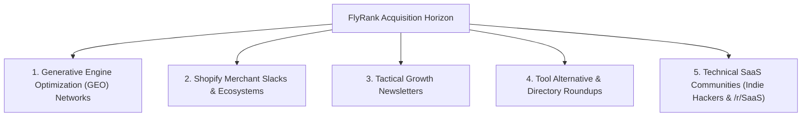

# Strategic Research Dossier: Untapped Acquisition Channels for FlyRank

**Track:** AI Marketing · Week 2 · Build Phase  
**Workload:** 3h  
**Candidate:** KM Siam (`k.m.siam2019@gmail.com`)  
**Product:** FlyRank — Autonomous SEO & Generative Engine Optimization (GEO) Intelligence Platform  
**Target Audience:** Bootstrapped & Funded SaaS Founders, E-commerce Store Owners (Shopify/Woo), Marketing Directors, and SEO/Performance Agency Operators.

---

## 1. Executive Summary & The "Status Quo" Trap

FlyRank currently relies on conventional B2B growth motions:
- **Meta Ads (Facebook & Instagram):** High CPM inflation, declining post-cookie attribution accuracy, and low intent for complex B2B workflow adoption.
- **Cold Outbound Email:** Saturated inboxes, deliverability penalties (Google/Yahoo sender restrictions), and high SDR burn.
- **LinkedIn Sponsored & Organic Content:** Escalating CPCs ($12–$25 per click), cluttered newsfeeds, and passive browsing patterns.

### The Strategic Shift
To unlock sub-\$50 blended Customer Acquisition Cost (CAC) and capture high-intent buyers during moments of active problem discovery, FlyRank must meet operators **where technical decisions are discussed, peer-recommended, and indexed by AI search engines**.

---

## 2. Evaluation Matrix for Untapped Channels

Channels were evaluated across five criteria on a 1–5 scale:
1. **Audience Intent (AI):** Are users actively solving ranking, visibility, or traffic loss issues?
2. **Channel Saturation (CS):** Is FlyRank competing against 50 legacy SEO platforms, or is the space wide open?
3. **Execution Speed (ES):** Can a proof-of-concept experiment launch in $\le 7$ business days?
4. **Cost Efficiency (CE):** What is the budget required to run a meaningful signal test?
5. **Compounding Longevity (CL):** Does content/presence deliver long-term organic authority?

---

## 3. The Ranked Shortlist: 5 High-Leverage Untapped Channels

---

### Channel 1 (Rank 1): Generative Engine Optimization (GEO) & AI Citation Networks
*Where AI Search Engines and LLMs Source Recommendations (Perplexity Pages, ChatGPT Search Citations, Cursor/Claude Tool Roundups)*

- **What It Is:**  
  As search evolves from 10 blue Google links to conversational LLM synthesis (SearchGPT, Perplexity, Gemini Search), founders and marketers are using AI search to ask: *"What is the best AI tool for programmatic SEO?"* or *"How to automate e-commerce schema markup in 2026?"*. GEO citation seeding involves publishing authoritative, structured markdown benchmarks, comparison data, and programmatic documentation in locations LLM crawlers prioritize (GitHub repositories, Hugging Face spaces, Perplexity Collections, and high-PageRank technical registries).
- **Why FlyRank's Audience Is There:**  
  Forward-thinking marketers and technical founders have already migrated their search habits from Google to Perplexity and ChatGPT Search. When an agency CEO asks Perplexity for modern SEO automation tools, FlyRank must be the top cited entity in the synthesized answer.
- **Cost & Effort:**  
  - *Setup Cost:* $0 (Organic asset seeding)  
  - *Time to Launch:* 4–6 hours (Authoring structured comparison tables, schema markup, and markdown documentation).
- **One-Line Test Plan:**  
  > *Publish an open-source, CC-licensed "2026 Generative Engine Optimization (GEO) Benchmark & Schema Blueprint" on GitHub and Perplexity Pages, tracking LLM citation inclusion and referral traffic via UTM parameters.*

---

### Channel 2 (Rank 2): Private Shopify Merchant Networks & Agency Slacks
*eCom Fuel, Quick E-Commerce Founders, Trends.vc, Agency Builders Slack*

- **What It Is:**  
  Gated, high-trust communities where 7- and 8-figure Shopify brand founders, CMOs, and agency owners discuss algorithm updates, Google organic traffic drops, and app stack optimizations without vendor noise.
- **Why FlyRank's Audience Is There:**  
  E-commerce brands are bleeding organic search share to AI search overviews and giant marketplaces. In private Slacks, merchants constantly ask: *"Has anyone found a way to automate collection page SEO and internal linking without hiring another freelancer?"*
- **Cost & Effort:**  
  - *Setup Cost:* $0–$150 (Community membership fee or founder invitation).  
  - *Time to Launch:* 3 hours (Locating active threads, crafting non-promotional technical breakdowns).
- **One-Line Test Plan:**  
  > *Offer 5 free, automated "Autonomous SEO & Broken Schema Teardowns" to active store owners in the `#seo-growth` channel of an e-commerce founders Slack, converting findings into high-trust case studies.*

---

### Channel 3 (Rank 3): Micro-Sponsorships in Tactical Operator Newsletters
*Demand Curve, Marketing Against the Grain, The Pragmatic Engineer, Growth Unhinged*

- **What It Is:**  
  Direct sponsorship of curated, highly technical marketing and engineering newsletters with 10k–50k engaged subscribers and >40% open rates, specifically targeting modern growth operators rather than broad consumer lists.
- **Why FlyRank's Audience Is There:**  
  CEOs, VPs of Growth, and marketing directors read these newsletters with high intent because they contain actionable playbooks, tool stacks, and tactical experiments rather than fluff.
- **Cost & Effort:**  
  - *Setup Cost:* $300–$600 per placement.  
  - *Time to Launch:* 1 week (Copywriting a 50-word native ad unit and building a targeted landing page).
- **One-Line Test Plan:**  
  > *Book a single native ad slot in a tactical marketing newsletter featuring the headline: "We automated 500 programmatic SEO pages in 10 minutes—here’s the live case study & free scanner."*

---

### Channel 4 (Rank 4): High-Intent "Alternative To" & Tool Comparison Directory Roundups
*AlternativeTo, SourceForge, SaaSHub, Product Hunt Collections*

- **What It Is:**  
  Optimized presence on software alternative directories where buyers explicitly search for alternatives to expensive legacy platforms like Semrush, Ahrefs, and Surfer SEO.
- **Why FlyRank's Audience Is There:**  
  Users searching "Surfer SEO alternative" or "Semrush for startups" are already at the bottom of the purchase funnel; they have a defined budget, an urgent problem, and actively seek a modern, cost-effective replacement.
- **Cost & Effort:**  
  - *Setup Cost:* $0 (Organic profile setup and community reviews)  
  - *Time to Launch:* 2 hours (Setting up product profiles, comparison matrices, and user review links).
- **One-Line Test Plan:**  
  > *Publish optimized listing profiles on AlternativeTo and SaaSHub positioning FlyRank as the "Autonomous Next-Gen AI Alternative to Surfer SEO", driving traffic to an interactive feature-matrix landing page.*

---

### Channel 5 (Rank 5): Technical SaaS Communities & Build-in-Public Forums
*Indie Hackers, /r/SaaS, /r/BigSEO, Twitter/X Tech Community*

- **What It Is:**  
  Engaging directly in public developer and founder forums where builders share launch metrics, traffic drops, and marketing experiments in real time.
- **Why FlyRank's Audience Is There:**  
  Founders are notoriously skeptical of traditional advertisements. They respond to transparent, transparent "build in public" case studies that break down exact ranking metrics, revenue impact, and technical execution details.
- **Cost & Effort:**  
  - *Setup Cost:* $0  
  - *Time to Launch:* 3 hours (Writing a detailed breakdown post sharing genuine SEO audit learnings).
- **One-Line Test Plan:**  
  > *Post a zero-pitch technical teardown on /r/SaaS: "How 10 SaaS companies lost 60% of Google traffic in the latest Helpful Content Update—and the 3-step programmatic fix we used."*

---

## 4. Prioritization Matrix & 30-Day Testing Roadmap

| Priority Rank | Channel Name | Estimated CAC | Effort | Initial Test Budget | Time to Signal |
| :---: | :--- | :---: | :---: | :---: | :---: |
| **#1 (Top Bet)** | **GEO & AI Citation Seeding** | **<$20** | Low | $0 | 7–10 Days |
| **#2** | **Private Shopify Merchant Slacks** | **<$35** | Low | $0 | 5–7 Days |
| **#3** | **Tactical Newsletter Sponsorships** | **~$50** | Med | $350 | 14 Days |
| **#4** | **"Alternative To" Directories** | **<$25** | Low | $0 | 14 Days |
| **#5** | **Build-in-Public SaaS Communities** | **<$15** | Med | $0 | 3–5 Days |

---

## 5. First 30-Day Action Blueprint

1. **Days 1–7 (Test 1 - GEO Seeding):** Author and distribute the open-source Generative Engine Optimization benchmark markdown document. Monitor Perplexity and ChatGPT Search citations.
2. **Days 8–14 (Test 2 - Merchant Slacks):** Join 2 vetted Shopify merchant communities; execute 5 free automated SEO audit teardowns for members.
3. **Days 15–21 (Test 3 - SaaS Community Teardown):** Publish the Reddit `/r/SaaS` case study detailing programmatic SEO fixes, linking to the FlyRank live scanner.
4. **Days 22–30 (Review & Scale):** Compare cost-per-lead, conversion rate, and pipeline value across the 3 test channels. Allocate 80% of growth budget to the winner.
